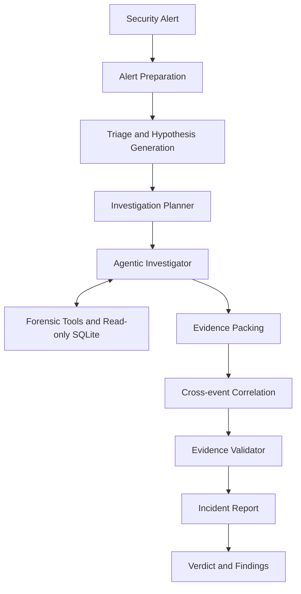

# A1 — Agentic AI Investigator for Endpoint Security Logs

An autonomous **Agentic AI-powered Digital Forensics and Incident Response (DFIR)** system that investigates endpoint security alerts by exploring telemetry, generating and testing hypotheses, correlating evidence across hosts, and producing structured incident reports with verifiable evidence.

Built with **Python, LangGraph, LangChain, SQLite, and FastAPI**, A1 combines LLM-driven investigation with deterministic evidence validation to make security investigations more traceable and reliable.

## Overview

Security alerts often contain only a small part of an incident. Analysts need to examine process activity, authentication events, file operations, registry changes, and network connections to understand what happened.

A1 automates much of this investigation workflow. Given an alert or investigation prompt, the system:

1. Prepares and interprets the incoming alert.
2. Generates competing hypotheses about the activity.
3. Plans and executes targeted forensic queries against endpoint telemetry.
4. Builds an evidence graph connecting hosts, users, processes, files, IP addresses, and domains.
5. Correlates evidence and identifies missing information.
6. Validates cited evidence directly against the source database.
7. Produces a structured incident report with a verdict and confidence assessment.

The system is designed to distinguish confirmed evidence from inference, uncertainty, and missing telemetry. Suspicious activity is not automatically treated as malicious.

## Key Features

- **Agentic investigation workflow:** A multi-step LangGraph workflow coordinates triage, planning, investigation, correlation, validation, and reporting.
- **Hypothesis-driven analysis:** Creates and updates competing explanations as new evidence is discovered.
- **Adaptive investigation planning:** Prioritizes useful forensic queries and avoids repetitive investigation steps.
- **Evidence graph:** Represents relationships between hosts, users, processes, files, IP addresses, domains, and registry keys.
- **Evidence validation:** Checks cited event IDs and relevant relationships against the underlying SQLite telemetry before report generation.
- **Multi-host correlation:** Helps connect related activity across multiple endpoints.
- **Conservative verdicts:** Supports outcomes such as benign, suspicious, malicious, and inconclusive, depending on the available evidence.
- **Interactive web interface:** Provides a browser-based investigation workbench with streaming updates and forensic visualizations.
- **CLI and benchmark support:** Run individual investigations or evaluate the system against included scenarios.
- **Multiple LLM providers:** Supports Ollama and OpenAI model configurations.

## System Architecture



The investigator uses specialized tools to query telemetry and can repeat the investigation cycle while useful evidence remains to be collected. Investigation limits and repetition checks help prevent unbounded loops.

## Technology Stack

| Area | Technologies |
|---|---|
| Programming language | Python 3.12+ |
| Agent orchestration | LangGraph |
| LLM integration | LangChain |
| Model providers | Ollama, OpenAI |
| Data storage | SQLite |
| Backend / Web API | FastAPI |
| Web server | Uvicorn |
| Data validation | Pydantic |
| Testing | Pytest |

## Project Structure

```text
.
├── docs/
│   └── EVALUATION_SCORING_RUBRICS.md
├── endpoint_security_dataset_expanded_corrected/
│   ├── groundtruth/
│   ├── *.db
│   ├── README.md
│   └── schema.md
├── scripts/
│   └── smoke_test.py
├── src/
│   └── a1/
│       ├── nodes/          # Investigation workflow nodes
│       ├── prompts/        # Agent and workflow prompts
│       ├── tools/          # Specialized forensic tools
│       ├── web/            # FastAPI web interface
│       ├── benchmark.py    # Scenario benchmark runner
│       ├── db.py           # Read-only SQLite access
│       ├── evidence_graph.py
│       ├── graph.py        # LangGraph workflow assembly
│       ├── hypothesis.py   # Hypothesis tracking
│       ├── llm.py          # LLM provider configuration
│       └── cli.py          # Command-line interface
├── tests/
├── .env.example
├── ARCHITECTURE.md
├── pyproject.toml
├── requirements.txt
└── README.md
```

## Getting Started

### Prerequisites

- Python 3.12 or later
- An Ollama Cloud API key or a configured local Ollama instance, or an OpenAI API key
- Git

### 1. Clone the repository

```bash
git clone https://github.com/<your-username>/<your-repository>.git
cd <your-repository>
```

### 2. Create and activate a virtual environment

**Windows PowerShell:**

```powershell
python -m venv .venv
.venv\Scripts\Activate.ps1
```

**macOS / Linux:**

```bash
python3 -m venv .venv
source .venv/bin/activate
```

### 3. Install dependencies

```bash
python -m pip install -r requirements.txt
```

Alternatively, if you use `uv`:

```bash
uv sync
```

### 4. Configure environment variables

Create a `.env` file from the example:

**Windows PowerShell:**

```powershell
Copy-Item .env.example .env
```

**macOS / Linux:**

```bash
cp .env.example .env
```

Set the credentials for the provider you want to use. For example, for Ollama Cloud:

```env
LLM_PROVIDER=ollama
OLLAMA_MODEL_NAME=gemma4:31b
OLLAMA_BASE_URL=https://ollama.com/api
OLLAMA_API_KEY=your_ollama_api_key
```

Or configure OpenAI:

```env
LLM_PROVIDER=openai
OPENAI_API_KEY=your_openai_api_key
OPENAI_MODEL_NAME=gpt-4o-mini
```

Keep your real `.env` file and API keys private. Do not commit credentials to GitHub.

## Running the Project

### Web interface

Start the web application:

```bash
python -m a1.web.server
```

Then open:

```text
http://127.0.0.1:8000/
```

The web workbench provides an interactive interface for submitting investigation prompts, viewing streamed agent activity, inspecting forensic evidence, and reviewing incident reports.

### Command-line investigation

Run an investigation using the CLI:

```bash
python -m a1.cli "Investigate suspicious PowerShell activity. Examine process ancestry, file activity, authentication events, and network connections. Separate confirmed evidence from assumptions and identify any missing telemetry."
```

To select a particular telemetry database, use `--db`:

```bash
python -m a1.cli "Investigate suspicious activity and determine whether it indicates lateral movement." --db endpoint_security_dataset_expanded_corrected/attack_lateral_movement.db
```

### Useful CLI options

| Option | Purpose |
|---|---|
| `--db` | Select the SQLite telemetry database |
| `-p`, `--provider` | Select the model provider (`ollama` or `openai`) |
| `-m`, `--model` | Select a model name or tag |
| `--select-llm` | Interactively select an available model |
| `-v`, `--verbose` | Display detailed investigation activity |
| `--web` | Launch the web interface |
| `--benchmark` | Run benchmark evaluation |

For the complete command syntax, run:

```bash
python -m a1.cli --help
```

## Dataset and Evaluation

The repository includes synthetic endpoint telemetry in SQLite databases for a range of investigation scenarios, including:

- Credential access and lateral movement
- Data staging and exfiltration
- Ransomware activity
- Living-off-the-Land and fileless activity
- SIEM/EDR telemetry scenarios
- Network intrusion and command-and-control activity
- Supply-chain compromise
- Benign administrative activity
- Ambiguous activity and incomplete telemetry

Ground-truth files are maintained separately under `endpoint_security_dataset_expanded_corrected/groundtruth/` for evaluation. The dataset documentation describes the scenarios, schema, and intended separation between agent-accessible telemetry and evaluator-only labels. The included telemetry is synthetic and should not be interpreted as live threat-intelligence data.

Run the benchmark:

```bash
python -m a1.benchmark
```

Or run a limited number of benchmark cases:

```bash
python -m a1.cli --benchmark --limit 5
```

The project also includes an evaluation rubric and experiment runner for comparing investigation configurations. See `docs/EVALUATION_SCORING_RUBRICS.md` and `ARCHITECTURE.md` for details.

## Tests

Run the test suite:

```bash
python -m pytest tests/
```

Run the standalone smoke test:

```bash
python scripts/smoke_test.py
```

## Configuration

The main environment variables are:

| Variable | Description |
|---|---|
| `LLM_PROVIDER` | LLM provider: `ollama` or `openai` |
| `OLLAMA_MODEL_NAME` | Ollama model name or tag |
| `OLLAMA_BASE_URL` | Ollama API base URL |
| `OLLAMA_API_KEY` | Ollama Cloud API key, if required |
| `OLLAMA_NUM_CTX` | Ollama context window setting |
| `OPENAI_API_KEY` | OpenAI API key |
| `OPENAI_MODEL_NAME` | OpenAI model name |
| `OPENAI_BASE_URL` | Optional custom OpenAI-compatible base URL |
| `ENDPOINT_DB_PATH` | Optional path to the telemetry database |
| `MAX_INVESTIGATION_STEPS` | Maximum investigator loop steps |

See `.env.example` and `src/a1/config.py` for the supported settings and defaults.

## Documentation

- [`ARCHITECTURE.md`](ARCHITECTURE.md) — Detailed architecture, workflow, and implementation notes.
- [`docs/EVALUATION_SCORING_RUBRICS.md`](docs/EVALUATION_SCORING_RUBRICS.md) — Evaluation criteria and scoring rubric.
- [`endpoint_security_dataset_expanded_corrected/README.md`](endpoint_security_dataset_expanded_corrected/README.md) — Dataset overview and evaluation-surface guidance.
- [`endpoint_security_dataset_expanded_corrected/schema.md`](endpoint_security_dataset_expanded_corrected/schema.md) — Telemetry schema documentation.

## Security Notes

- The application is intended for controlled research, testing, and defensive security investigation.
- The included endpoint telemetry is synthetic.
- Database access is designed to be read-only during investigations.
- Keep API keys and other secrets out of source control.
- Always review findings and recommendations before taking action in a production environment.

## License

This project is distributed under the license included in the [`LICENSE`](LICENSE) file.
